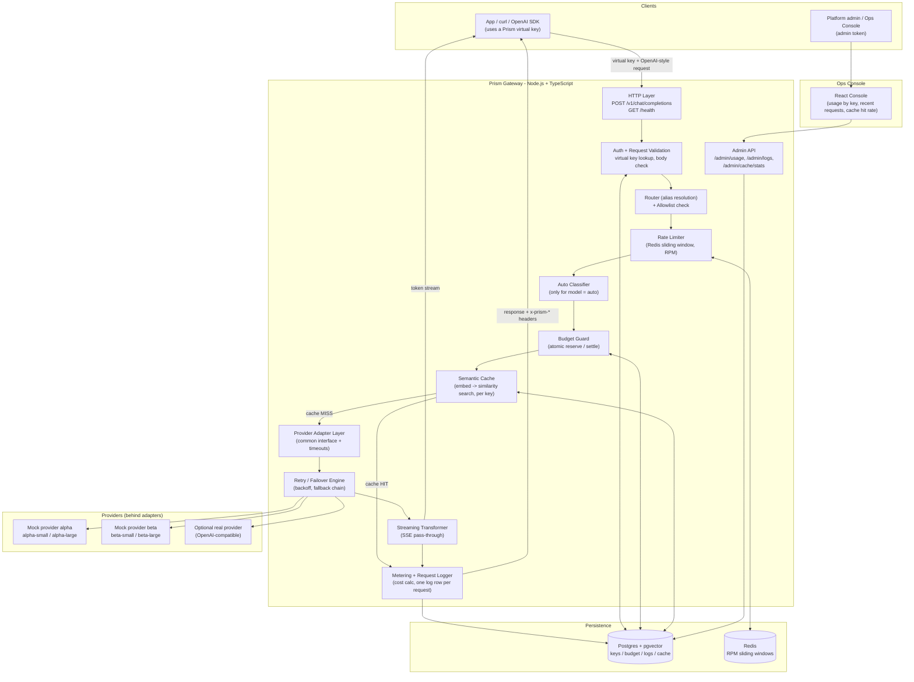
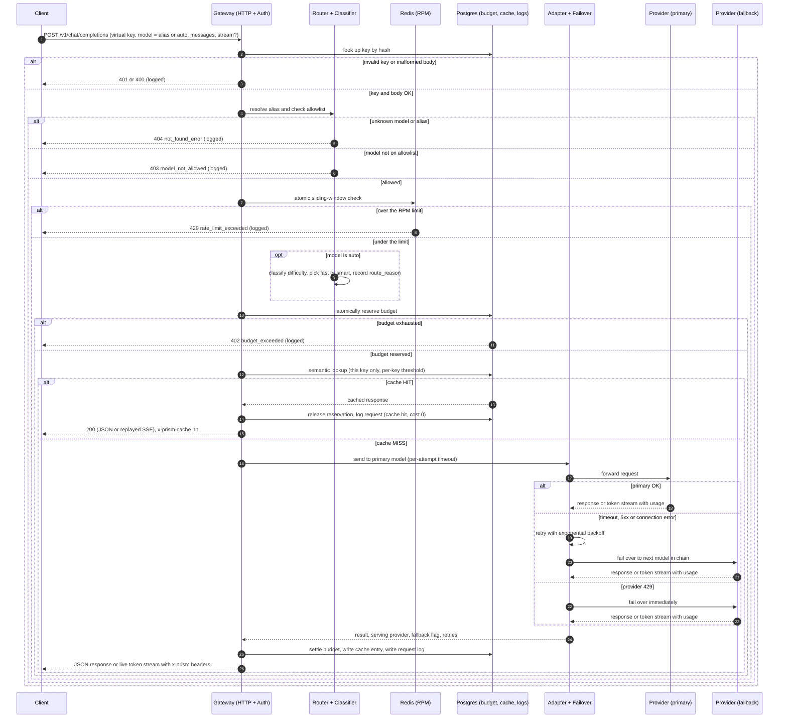

# Prism — Architecture

**Stack (locked in):** Backend — Node.js + TypeScript. Frontend (Ops Console) — React. Datastores — Postgres (+ `pgvector`) and Redis. Local/demo runtime — Docker Compose.
**Source of truth for requirements:** [`docs/context.md`](context.md) / `docs/PS1.pdf`, plus the starter pack in `data/` and `scripts/` (its `API_CONTRACT`, `DATA_MODEL`, `EVALUATION_GUIDE` and `IMPLEMENTATION_GUIDE` documents are in the [`prism-capstone`](https://github.com/airtribe-projects/prism-capstone) repo).

This document explains *how* we'll build Prism so that nothing in the problem statement is missed, and so every design choice has a reason behind it. Read it top to bottom once — after that, use it as a reference while building.

Companion docs: [`implementation-plan.md`](implementation-plan.md) (build phases), [`eval.md`](eval.md) (how we prove it works), [`edgecase.md`](edgecase.md) (edge cases and decisions).

---

## 1. Design Principles (why these decisions, not others)

Every decision below is driven directly by a requirement in the problem statement or the starter pack:

| Requirement | Design consequence |
|---|---|
| OpenAI-compatible data plane, hide provider credentials | A single **adapter interface** — callers never see provider-specific payloads or keys. |
| `x-prism-*` header contract on every response (smoke test and load test depend on it) | Headers are built in **one place** and wired from day one, so no code path can skip them. |
| Streaming token-by-token, no buffering | Gateway must **pipe streams through**, not accumulate-then-send. |
| Accounting/rate-limits correct **under concurrency** (load test checks zero over-admission) | State mutations (budget, RPM) must be **atomic at the datastore** (Redis Lua script, Postgres row update), never read-then-write in app code. |
| No hang on a dead/slow provider | **Every** outbound call wrapped in a timeout, plus an overall request deadline. |
| Swap mock ↔ real providers without touching core logic | Providers live behind a **port/adapter**; core gateway only knows the interface. |
| Judge difficulty, beat a length-only baseline (about 60% on the provided eval set) | Classifier must use **signal beyond raw length**, and must never use the eval labels in its logic. |
| Cache by meaning, scoped per tenant, configurable per key | Needs an **embedding + similarity search**, always filtered by tenant key, with per-key on/off and threshold. |
| Full observability for debugging, including rejections | **One row per request** in a durable log — rejected requests too — with every field the spec lists. |

---

## 2. High-Level Architecture



**Read it as a pipeline.** Every request walks through the gateway's middleware chain in a fixed, documented order: *Auth → Validate → Resolve model → Allowlist → Rate limit → (classify `auto`) → Budget → Cache → Provider (with retry/failover) → Meter*. Each stage can short-circuit the request (reject, or serve from cache) before it ever reaches a provider. The mock providers are the two `scripts/mock_provider.py` processes from the starter pack; failure injection (down, slow, flaky, rate-limited) happens on *their* `/admin/config` endpoint, not in the gateway.

---

## 3. Request Lifecycle — Step by Step

This is the core of the system. Walk through it once and the rest of the doc is just "how each box works."



**In plain words:**

1. **Client calls** `/v1/chat/completions` with a virtual key and a model alias (`fast`, `smart`, or `auto`) — never a real provider name.
2. **Auth, then validation.** Unknown, malformed or disabled key → `401`. Then the body is validated (for example empty `messages` → `400`). Nothing is revealed to unauthenticated callers.
3. **Model resolution and allowlist.** An unknown model or alias → `404` (the smoke test expects a clear 4xx with an error body). A known model that is not on the key's allowlist → `403 model_not_allowed`. The allowlist holds the names callers send (`fast`, `smart`, `auto`), so it is checked against the requested name.
4. **Rate limit.** An atomic Redis check per key. Rejected before any provider is touched.
5. **`auto` classification.** `auto` runs the difficulty classifier, which picks `fast` or `smart`, records the tier and the reason in the request log, and then resolves like a normal alias. The chosen tier must itself be allowed for the key (see §4.4).
6. **Budget gate.** An atomic reservation in Postgres. Exhausted → `402 budget_exceeded`, and the rejection is logged. This runs *before* the cache, so a key with no budget left is rejected even for would-be cache hits.
7. **Semantic cache check**, scoped to *this key only*. If cache is enabled for the key and a sufficiently similar prompt was answered before, return that answer — no provider call, cost `0`, reservation released.
8. **On a cache miss**, the adapter layer calls the primary provider with a timeout. Transient failures get retried with backoff; persistent failures (and provider `429`s) trigger failover to the next provider/model in the chain, and that fact is recorded.
9. **Response leaves the gateway** either as a normal JSON body or as a live SSE token stream. Headers report which provider actually served it, whether it was a cache hit, and whether failover happened; non-streaming responses also carry the cost.
10. **Every request — hit, miss, success, failure, and every rejection — gets one row in the request log**, and usage/budget counters are settled atomically as part of the same flow.

### 3.1 Documented check order and its reasons

| Order | Stage | Failure | Why here |
|---|---|---|---|
| 1 | Authenticate key | `401` | Never reveal anything to unauthenticated callers. |
| 2 | Validate request body | `400` | Cheap, and malformed bodies must not touch Redis, Postgres or providers. |
| 3 | Resolve model / alias | `404` | An unknown model is a client error independent of policy. |
| 4 | Allowlist | `403` | Pure in-memory policy check; costs nothing. |
| 5 | Rate limit | `429` | Cheap Redis call; stops floods before any more expensive work. |
| 6 | `auto` classification | — | Needs the model tier before cost can be estimated for the budget reservation. |
| 7 | Budget reserve | `402` | Needs the resolved model for its cost estimate. |
| 8 | Cache lookup | — | Only requests that are allowed to spend reach it. |
| 9 | Provider call | `502` | Last, and the only stage that costs real money. |

---

## 4. Component Breakdown

### 4.1 HTTP Layer

- Framework: **Fastify** (TypeScript-first, schema validation built in, excellent streaming/raw-response support — a better fit than Express for a gateway whose job *is* request/response plumbing).
- **Data plane:** `POST /v1/chat/completions` (OpenAI-compatible, must stay stable because the smoke and load tests call it) and `GET /health`. The gateway listens on port `8080`, the default the starter scripts use.
- **Admin plane:** `GET /admin/usage?key=...&from=...&to=...`, `GET /admin/logs?key=...&limit=...`, `GET /admin/cache/stats`. `GET /admin/providers/health` is Good To Have. Admin routes are protected by one simple demo admin token (`ADMIN_TOKEN` env var, sent in an `x-admin-token` header).
- Authentication runs first; the OpenAI-compatible request shape is validated immediately after (see §3.1).
- A body-size limit rejects oversized payloads before any embedding or provider work.

### 4.2 Auth Middleware

- Looks up the virtual key (SHA-256 hashed at rest; the lookup is by hash) against the seeded key table.
- Attaches `{ keyId, team, allowedModels, rpmLimit, monthlyBudgetUsd, cache: { enabled, threshold } }` to the request context for every downstream stage to use.
- Missing, unknown, malformed or `disabled` key → `401` with type `authentication_error` and code `invalid_api_key`. The rejection is logged with a null key (the submitted value is never stored, so typos of real keys do not leak into logs).
- Raw keys never appear in logs or error messages.

### 4.3 Rate Limiter + Budget Guard

Three different checks, with three different mechanisms — the rate limit and budget must be race-free under concurrent requests:

- **Model allowlist** → in-memory check against the key's `model_allowlist`, no race possible. It matches the name the caller sent (`fast`, `smart`, `auto`).
- **Requests-per-minute** → Redis, one atomic Lua script per request, using a **sliding window** (a sorted set per key, `rpm:{keyId}`).
  - The script reads the time from Redis itself, drops entries older than 60 s, and — only if fewer than `rpmLimit` remain — adds this request and refreshes the key's TTL. It returns admit or reject (plus a retry-after hint).
  - A sliding window (not a fixed window) is deliberate: a fixed window can admit up to 2× the limit around a minute boundary, which would fail the provided load test (`accepted <= limit` for a burst).
  - Rejected requests are not recorded in the window, so a client that keeps hammering does not extend its own lockout.
  - A single Lua script is atomic in Redis, so it is safe across many concurrent requests and multiple gateway instances, and there is no window where the counter exists without a TTL.
  - One client request is exactly **one** RPM hit, regardless of internal retries or failover. Cache hits count (they are requests).
  - If Redis is unreachable the limiter **fails closed** (`503 service_unavailable`), with a short timeout on the Redis call. Protecting spend is preferred over availability.
- **Monthly budget** → Postgres, an atomic **reserve → settle** pattern. The final cost is unknown at admission time (completion tokens are not known, especially for streams), and the starter pack requires that the tiny-budget demo key lets exactly one request through and then rejects the next. So:
  1. **Admit** only if `spent_usd + reserved_usd < budget`, and in the same atomic statement reserve `LEAST(estimate, remaining)`. The estimate is prompt tokens plus the output cap (`max_tokens`, or a default cap) priced from the resolved model.
  2. **Settle** after the response: add the *actual* cost to `spent_usd` and release the reservation. A failed or cached request settles at `0`.

  ```sql
  -- Illustrative. Admission: lock the row, then reserve atomically.
  WITH candidate AS (
    SELECT key_id,
           LEAST($estimate, $budget - spent_usd - reserved_usd) AS amount
      FROM budget_usage
     WHERE key_id = $keyId AND period = $period
       AND spent_usd + reserved_usd < $budget
       FOR UPDATE
  )
  UPDATE budget_usage b
     SET reserved_usd = b.reserved_usd + candidate.amount
    FROM candidate
   WHERE b.key_id = candidate.key_id AND b.period = $period
  RETURNING candidate.amount AS reserved;

  -- Settlement.
  UPDATE budget_usage
     SET spent_usd = spent_usd + $actual,
         reserved_usd = reserved_usd - $reserved
   WHERE key_id = $keyId AND period = $period;
  ```

  Postgres takes a row lock the moment it finds the matching row, so concurrent requests against the same key serialize automatically — no separate lock needed. Zero rows returned → `402 budget_exceeded`, and nothing was reserved or charged.

  **Documented overshoot bound:** a request is admitted whenever any budget remains, so the single request that crosses the ceiling may exceed it by its own cost (this is the tiny-budget demo key's first request). Because that request reserves *all* of the remaining budget, concurrent requests are rejected while it is in flight, and everything after it is rejected once it settles. The worst-case overshoot is therefore **one request's cost**, and it is zero whenever the estimate is an upper bound on the real cost.
  - Budget windows are calendar months in UTC with reset-on-read: the first request of a new month lazily creates that month's row (`INSERT ... ON CONFLICT DO NOTHING`).
  - Money is never held in floating point (see §4.9).

Each rejection path returns a distinct, documented error (§6) — this is explicitly graded.

Optional (Good To Have, after the Must Have gateway works): **tokens-per-minute** limits using the same Redis pattern, driven by the `tokens_per_minute` values already present in the seed data.

### 4.4 Router (alias resolution + auto classifier)

- Aliases (`fast`, `smart`, `auto`), their fallback chains, the provider registry (`name`, `base_url`, `api_key`), the retry policy and the degradation thresholds come from `data/gateway_config.sample.json` (we keep its shape) — loaded once at startup, validated, kept in memory. Callers send an alias, or a configured model name that is on their allowlist; everything else is a `404`.
- `fast` → primary `alpha-small`, fallback `beta-small`. `smart` → primary `alpha-large`, fallback `beta-large`. `auto` maps `simple → fast` and `complex → smart` via `route_by_difficulty`.
- `auto` triggers a difficulty classifier that must beat a length-only baseline (about 60% on the provided set):
  - **Features:** structural signals (code blocks, math notation, proof/derive/prove/optimize/design vs. extract/lookup/translate/define verbs, multi-part prompts, the nature of the final instruction vs. the amount of context text), and embedding similarity to a small curated set of known-simple vs. known-complex exemplar prompts (nearest-centroid), reusing the same local embedding model as the semantic cache. Prompt length is at most a weak feature — never the decisive one.
  - **Long input handling:** only a bounded window of the prompt (and its final instruction) is classified, so long-but-trivial prompts stay cheap and are judged by the task asked, not by their size.
  - **No label leakage:** exemplars, weights and thresholds are authored and tuned on our own development prompts. `data/routing_eval.jsonl` is the answer key and is used for *measurement only* — `expected_tier` appears nowhere in routing logic.
  - This directly targets the spec's traps: short-but-hard prompts (proofs, systems debugging) and long-but-trivial ones (roster lookups, log extraction).
- Every `auto` decision records `route_reason` (chosen tier, score or matched signal) in the request log.
- **Allowlist interaction:** the classifier's tier must be allowed for the key. If the chosen tier (for example `smart`) is not allowed, the router downgrades to `fast` when that is allowed and logs the downgrade in `route_reason`; if neither is allowed the request is a `403 model_not_allowed`.
- **Output:** a concrete target model + its ordered fallback chain, handed to the adapter layer. The log and headers show the resolved model, not just `auto`.
- A one-command **routing eval** runs every case in `routing_eval.jsonl` through the classifier (classification only — no upstream call) and prints `{ total, correct, accuracy, cases: [{ id, expected, actual, reason }] }`.

### 4.5 Semantic Cache

- Cache is **per key and configurable per key**, from the seed data: `semantic_cache.enabled` and `similarity_threshold` (the seed uses 0.92 for `search`, 0.85 for `free-tier`; `research` and `budget-demo` have the cache off). With the cache off for a key, lookup and writes are skipped and the response reports `x-prism-cache: miss`.
- On the miss path, before calling a provider: embed the prompt, run a cosine-similarity search in Postgres via pgvector, filtered by `WHERE key_id = $current` **and** the cache scope below, above the key's threshold.
- **Cache scope and key — a documented decision:**
  - The lookup is always filtered by `key_id`. This is the tenant isolation guarantee, enforced in the query, not by convention.
  - It is also filtered by the resolved alias/tier (a `fast` answer never serves a `smart` request).
  - The similarity match runs on the **last user message**. Everything before it (system prompt and earlier turns) plus the sampling parameters that change an answer (`temperature`, `max_tokens`, `top_p`) must match exactly, through a context hash stored with the entry. This keeps multi-turn conversations safe from false hits.
- **Never cached:** error responses, anything that is not a complete success, partial/aborted streams, and time-sensitive prompts (for example "what is the *current* status of ...", the `req_no_cache` sample). Time-sensitivity is detected with a small, documented keyword heuristic.
- **Hit behavior:** return the stored response, record `cache=hit`, cost `0`, release the budget reservation, and skip the provider. For `stream: true`, the cached response is replayed as an SSE stream (a single content chunk followed by `data: [DONE]`) and `x-prism-cache` is set to `hit`.
- **Miss behavior:** after the provider responds successfully (for a stream, only once it completes), store `{ key_id, alias, context hash, embedding, prompt, response, model, hit_count, created_at }`.
- Embeddings are generated locally (e.g. `transformers.js` running a small sentence-embedding model in a worker thread, so it never blocks the event loop; warmed at startup) rather than via an external provider call — keeps the cache provider-agnostic, adds no extra cost, and doesn't leak prompts to a third party just to check the cache.
- **Threshold calibration:** the seed thresholds assume a particular embedding model. We verify the provided cases against the chosen model — pair A (`req_cache_a1`/`a2`) and pair B (`req_cache_b1`/`b2`) should hit, the near-miss `req_cache_a3` and an unrelated prompt must not. If the model's score distribution needs different values, the change is documented in the README and verification report.
- Failure in the cache path (embedding error, DB error) is treated as a **miss**; the request is still served. The cache never fails a request.

### 4.6 Provider Adapter Layer

A single interface every provider — mock or real — implements:

```ts
interface ProviderAdapter {
  name: string;
  chatCompletion(req: ChatRequest, opts: CallOptions): Promise<ChatResponse>;
  chatCompletionStream(req: ChatRequest, opts: CallOptions): AsyncIterable<ChatChunk>;
}
```

- Core gateway code only ever talks to this interface — it has no idea whether it's calling a mock or a real endpoint.
- **One concrete adapter** (`OpenAICompatibleAdapter`) speaks the OpenAI wire format against a `base_url` + `api_key`. The two mock providers, Ollama, Groq and OpenAI itself are all pointed at it by configuration only. A provider with a different wire format (for example Anthropic's Messages API) would need protocol translation and is out of scope (Stretch).
- An **in-process fake adapter** implements the same interface for fast, deterministic automated tests — this is the reason the integration sits behind an adapter.
- The mock providers are the starter's `scripts/mock_provider.py`: `alpha` on port 9001 and `beta` on 9002, serving `<name>-small` and `<name>-large`, token-by-token streaming (~20 ms per token), usage in both streaming and non-streaming responses, and live failure injection (`down`, `rate_limited`, `fail_rate`, `latency_ms`) on their own `/admin/config`.
- **Timeouts at the adapter boundary, always:** a connect/first-byte timeout, a per-chunk idle timeout for streams, and a separate overall request deadline in the gateway. Defaults are small enough for the demo (a mock made slow with `latency_ms: 3000` must trip them) and are configurable.
- Provider API keys are gateway secrets: never in responses, logs, the console, or error messages. Provider error bodies are mapped to a clean gateway error, never forwarded raw.

### 4.7 Retry / Failover Engine

- **Transient** errors (timeout, 5xx, connection reset) → retry with exponential backoff using the configured policy (`max_attempts: 3`, `initial_backoff_ms: 200`, `backoff_multiplier: 2`; jitter added).
- **Provider `429` (rate-limited)** → no retry; fail over immediately to the next model/provider in the chain.
- **Exhausted retries** → move to the next model/provider in the fallback chain, and set `fallback=true` for logging/headers.
- **Other provider 4xx** (bad request, auth to the provider failed, unknown model) → not retryable and not a failover case; mapped to `502 upstream_error` and logged.
- **Every provider in the chain fails** → `502 upstream_error`, logged, nothing billed.
- **Billing and rate-limit semantics:** a single client request counts as one RPM hit however many attempts it took, and only the attempt that actually produced the response is billed. The number of retries is logged (`retries`).
- **Recovery:** every request tries the primary first, so traffic returns to it as soon as it is healthy again (the Must Have behavior).
- **Provider health tracking (Good To Have, built after the Must Have works):** track per-provider error rate and latency over a window using the config's `degradation` thresholds, skip a provider that is clearly down or degraded, and probe it periodically so it is picked up again quickly. It also feeds `GET /admin/providers/health`.

### 4.8 Streaming Transformer

- When `stream: true`, the adapter returns an async iterable of chunks; the gateway pipes each chunk to the client as an SSE event as it arrives — no accumulation. Backpressure is respected.
- **Headers are held until the first upstream chunk arrives**, so `x-prism-provider` and `x-prism-fallback` are accurate. A failure *before* the first chunk is invisible to the client and can retry/fail over normally.
- Response headers on a stream: `x-prism-provider`, `x-prism-cache` and `x-prism-fallback` (the three that are required up front). `x-prism-cost-usd` is not sent on streams — the cost is not known yet; the final cost is written to the request log and usage API.
- Terminates with `data: [DONE]`, exactly once, on every success path including a cache replay.
- Usage is still captured from the final stream chunk (real providers can report it with `stream_options.include_usage`; the mock providers always send it), so streamed requests are metered too.
- **Mid-stream failure (documented behavior):** once any chunk has been sent, the gateway never switches provider or splices output. It sends a terminal SSE `error` event, then `data: [DONE]`, closes the stream, and logs the request as `upstream_error`.
- **Client disconnect:** the upstream request is aborted, resources are released, and the request is logged as `client_disconnect`.
- **Billing for an interrupted stream:** bill the tokens actually delivered, estimated from the content that was streamed and flagged `usage_estimated`; a stream that failed before delivering anything bills `0`.

### 4.9 Metering & Usage Logger

- Cost = provider-reported tokens × price-table rate for that model (from `data/model_pricing.json`, USD per 1M tokens, loaded at startup). Never computed from client-declared token counts.
- **Exact decimal math:** with prices quoted to two decimals per 1M tokens, every cost is an exact multiple of `0.00000001` USD. Cost is computed in integers (scaled units), stored as `NUMERIC`, and printed in the `x-prism-cost-usd` header with up to 8 decimals, so the load test's sum of cost headers reconciles exactly with the usage API. JavaScript floats are never accumulated.
- Writes one row per request, **including rejections**, to `request_logs` (fields in §5), with a `status` such as `ok`, `cache_hit`, `rejected_auth`, `rejected_validation`, `rejected_not_found`, `rejected_allowlist`, `rejected_rate_limit`, `rejected_budget`, `upstream_error`, `client_disconnect`.
- The request log row and the budget settlement are written together so they always reconcile.
- Backs the admin usage API the console reads from. The usage window is computed from `request_logs` with an index on `(key_id, created_at)`; the budget check itself reads only the small `budget_usage` row.
- Latency is total time as seen by the client; for streams it additionally records time to first token. Added gateway latency is measured by timestamping around the upstream call.

### 4.10 Ops Console (React)

- Three views, intentionally minimal: usage by key, recent requests (with status, route reason and fallback flag), cache hit rate.
- Reads only from the admin API (`/admin/usage`, `/admin/logs`, `/admin/cache/stats`) using the demo admin token — no direct DB access from the frontend. `GET /admin/usage` without a `key` returns every key's totals so the console can show usage by key.

---

## 5. Data Model (Postgres)

| Table | Key columns | Purpose |
|---|---|---|
| `virtual_keys` | `id`, `key_hash`, `team`, `status` (active/disabled), `monthly_budget_usd`, `rpm_limit`, `tpm_limit` (nullable), `allowed_models[]`, `cache_enabled`, `cache_threshold`, `created_at` | Seeded from `seed_keys.json`; exact key values and team names preserved; source of truth for auth + policy |
| `budget_usage` | `key_id`, `period` (YYYY-MM, UTC), `spent_usd`, `reserved_usd` | Atomic monthly spend counter (reserve → settle pattern above) |
| `request_logs` | `request_id`, `key_id` (null for unknown keys), `requested_model`, `resolved_provider`, `resolved_model`, `status`, `prompt_tokens`, `completion_tokens`, `cost_usd`, `cache` (hit/miss), `fallback`, `route_reason`, `retries`, `usage_estimated`, `latency_ms`, `created_at` | One row per request, rejections included — debugging + usage API + load test verification |
| `cache_entries` | `id`, `key_id`, `alias`, `context_hash`, `prompt_text`, `embedding` (vector), `response_json`, `model`, `hit_count`, `created_at`, `expires_at` (nullable) | Semantic cache storage; pgvector similarity search, always filtered by `key_id` and `alias` |

Static/config data (`model_pricing.json`, `gateway_config.sample.json`) is loaded into memory at startup and validated (every alias target must exist in the price table; fallbacks must be served by a registered provider) rather than duplicated into tables — it's reference data, not transactional state. Provider names, model names, alias names and seed key values are preserved exactly, because the demo flow and the starter scripts reference them.

Redis holds only ephemeral rate-limit windows (`rpm:{keyId}` → sorted set of recent request timestamps, TTL 60 s). Nothing in Redis is a system of record; losing it just resets rate windows.

Keys, logs, usage and cache entries all survive a gateway restart (they live in Postgres).

---

## 6. Error Taxonomy

OpenAI-style error envelope; every case is distinguishable from the body, as required:

```json
{
  "error": {
    "message": "Monthly budget of $5.00 exhausted for this key",
    "type": "budget_exceeded",
    "code": "budget_exceeded"
  }
}
```

| HTTP | `error.type` | `error.code` | Trigger |
|---|---|---|---|
| 401 | `authentication_error` | `invalid_api_key` | Key missing, unknown, malformed or disabled |
| 400 | `invalid_request_error` | `invalid_request` | Malformed body (for example empty `messages`) |
| 404 | `not_found_error` | `model_not_found` | Unknown model or alias |
| 403 | `model_not_allowed` | `model_not_allowed` | Requested model is not on the key's allowlist |
| 429 | `rate_limit_exceeded` | `rate_limit_exceeded` | RPM exceeded |
| 402 | `budget_exceeded` | `budget_exceeded` | Monthly budget exhausted |
| 502 | `upstream_error` | `upstream_error` | All providers in the chain failed, or a non-retryable provider error |
| 503 | `service_unavailable` | `rate_limiter_unavailable` | Redis (rate limiter) unreachable — fails closed |

Provider API keys, raw virtual keys and internal URLs never appear in any error message.

---

## 7. Proposed Repo Layout

```text
prism/
  docker-compose.yml        # postgres (pgvector), redis, alpha, beta, gateway, console
  .env.example              # ADMIN_TOKEN, DB/Redis URLs, timeouts
  apps/
    gateway/                # Node.js + TypeScript backend
      src/
        http/               # Fastify server, data-plane route handlers
        admin/              # /admin/usage, /admin/logs, /admin/cache/stats
        middleware/         # auth, validation, allowlist, rate-limit, budget
        routing/            # alias resolution, fallback chains, difficulty classifier
        cache/              # embedding + similarity search
        providers/          # adapter interface, OpenAI-compatible adapter, in-process fake
        metering/           # cost calc, usage logging
        db/                 # schema, migrations, queries
        config/             # loaders for seed JSON files
      test/
    console/                # React ops console
  packages/
    shared-types/           # TS types shared by gateway + console (DTOs, header contract)
  data/                     # model_pricing.json, seed_keys.json, gateway_config.sample.json,
                            # routing_eval.jsonl, sample_requests.jsonl (from starter repo)
  scripts/                  # smoke_test.py, load_test.py, mock_provider.py, validate_pack.py
                            # (from starter repo), plus our routing-eval command
  docs/
```

---

## 8. Traceability — Requirement → Component

| Requirement (PS1 / starter pack) | Covered by |
|---|---|
| Load provided data | §4.4 / §5 config loaders, seed script |
| Unified Chat Completions API, header contract | §4.1, §4.6, §4.8 |
| Streaming pass-through, usage still recorded | §4.8 |
| Virtual keys, rate limits, budgets | §4.2, §4.3, §6 |
| Routing, retries, failover | §4.4, §4.7 |
| `auto` smart routing, logged decision, routing eval | §4.4 |
| Semantic response cache (per key, per-key config) | §4.5 |
| Metering, logs (including rejections), usage API | §4.9, §5 |
| Ops console | §4.10 |
| Persistent store | §5 |
| Concurrency correctness | §4.3 |
| Provider timeouts, malformed upstream and mid-stream failures | §4.6, §4.7, §4.8 |
| Provider adapter abstraction | §4.6 |
| Automated tests for critical logic | [`eval.md`](eval.md) §4 |

**Scope boundary.** Everything above that is marked *Good To Have* (tokens-per-minute, provider health endpoint, degradation-based routing, key-management APIs) or *Stretch* is only attempted after the Must Have gateway works end to end.

---

## 9. Decisions

### 9.1 Confirmed

| Decision | Choice |
|---|---|
| Rate limiting | **Redis** (atomic Lua sliding window). Postgres for everything else. |
| Providers | **Mocks first** (the starter's `alpha` and `beta`), then one optional real OpenAI-compatible provider swapped in by configuration. |
| Embeddings | **Local model** (`transformers.js`, in-process worker) for both the cache and the classifier. |
| Deployment | **Docker Compose** (gateway, console, Postgres, Redis, both mock providers) as the one-command local and demo setup. |

### 9.2 Design decisions from the starter contract

| Topic | Decision |
|---|---|
| Error shape and codes | §6, following the starter's suggested `type` mapping; budget exhaustion is `402`. |
| Admin API | `/admin/usage`, `/admin/logs`, `/admin/cache/stats` behind an `x-admin-token` header. |
| Check order | Auth → validate → resolve → allowlist → rate limit → classify → budget → cache → provider (§3.1). |
| Budget admission | Reserve-then-settle; worst-case overshoot is one request's cost (§4.3). |
| Streaming cost header | Not sent on streams; final cost goes to the log and usage API. |
| Mid-stream failure | Error event, then `[DONE]`; never splice providers (§4.8). |
| Streaming cache hit | Replay as a single SSE chunk followed by `[DONE]`. |
| Cache scope | Key, alias/tier, last-user-message similarity, exact context hash (§4.5). |
| Time-sensitive prompts | Never cached. |
| Failover triggers | Timeout, 5xx and connection errors (after retries) and provider `429` (immediately). |
| Provider recovery | Primary is tried first on every request; health tracking is Good To Have. |
| Routing eval | Classification-only, one command, labels never used in logic. |

### 9.3 Still open

- **Docker Desktop** must be installed locally before Phase 0's exit criteria can be verified.
- **Cache thresholds** are calibrated against the chosen embedding model in Phase 8; any change to the seeded values is documented.

Once Docker is available, implementation starts at Phase 0 of [`implementation-plan.md`](implementation-plan.md).
