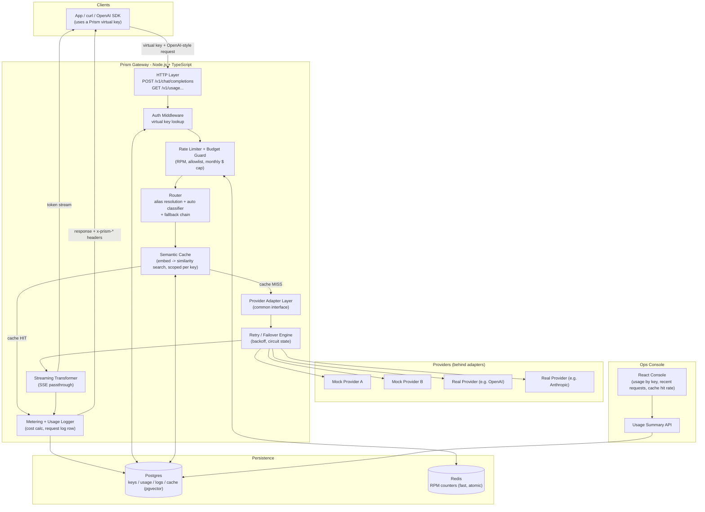
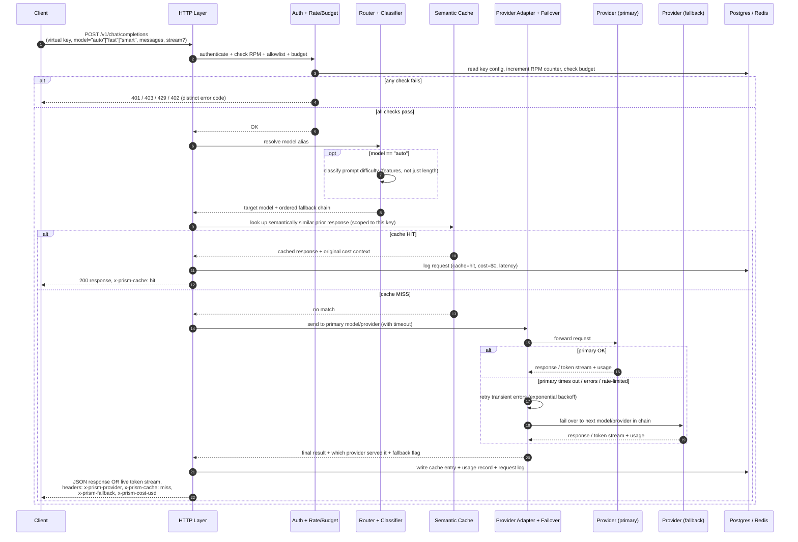

# Prism — Architecture

**Stack (locked in):** Backend — Node.js + TypeScript. Frontend (Ops Console) — React.
**Source of truth for requirements:** [`docs/context.md`](context.md) / `docs/PS1.pdf`.

This document explains *how* we'll build Prism so that nothing in the problem statement is missed, and so every design choice has a reason behind it. Read it top to bottom once — after that, use it as a reference while building.

---

## 1. Design Principles (why these decisions, not others)

Every decision below is driven directly by a requirement in the problem statement:

| Requirement (PS1) | Design consequence |
|---|---|
| OpenAI-compatible data plane, hide provider credentials | A single **adapter interface** — callers never see provider-specific payloads or keys. |
| Streaming token-by-token, no buffering | Gateway must **pipe streams through**, not accumulate-then-send. |
| Accounting/rate-limits correct **under concurrency** | State mutations (budget, RPM) must be **atomic at the datastore**, not just "sequential in app code." |
| No hang on a dead/slow provider | **Every** outbound call wrapped in a timeout. |
| Swap mock ↔ real providers without touching core logic | Providers live behind a **port/adapter**; core gateway only knows the interface. |
| Judge difficulty, beat a length-only baseline | Classifier must use **signal beyond raw length** (semantic/structural features). |
| Cache by meaning, scoped per tenant | Needs an **embedding + similarity search**, always filtered by tenant key. |
| Full observability for debugging | **One row per request** in a durable log, with every field the spec lists. |

---

## 2. High-Level Architecture



**Read it as a pipeline.** Every request walks left-to-right through the gateway's middleware chain: *Auth → Rate/Budget → Route → Cache → Provider (with retry/failover) → Meter*. Each stage can short-circuit the request (reject, or serve from cache) before it ever reaches a provider.

---

## 3. Request Lifecycle — Step by Step

This is the core of the system. Walk through it once and the rest of the doc is just "how each box works."



**In plain words:**

1. **Client calls** `/v1/chat/completions` with a virtual key and a model alias (`fast`, `smart`, or `auto`) — never a real provider name.
2. **Auth + Rate/Budget gate.** Is the key valid? Is this model on its allowlist? Has it exceeded requests/minute? Is it over its monthly budget? Any "no" → reject immediately with a specific error, before touching any provider (so we never pay for a request that shouldn't have happened).
3. **Router resolves the alias.** `fast`/`smart` map directly to a model + fallback chain from config. `auto` first runs the difficulty classifier, which picks `fast` or `smart`, then resolves the same way.
4. **Semantic cache check**, scoped to *this key only*. If a sufficiently similar prompt was answered before for this tenant, return that answer — no provider call, no cost.
5. **On a cache miss**, the adapter layer calls the primary provider with a timeout. Transient failures get retried with backoff; persistent failures trigger failover to the next provider/model in the chain, and that fact is recorded.
6. **Response leaves the gateway** either as a normal JSON body or as a live SSE token stream — either way, headers report which provider actually served it, whether it was a cache hit, whether failover happened, and what it cost.
7. **Every request — hit, miss, success, failure — gets one row in the request log**, and usage/budget counters update atomically as part of the same flow.

---

## 4. Component Breakdown

### 4.1 HTTP Layer

- Framework: **Fastify** (TypeScript-first, schema validation built in, excellent streaming/raw-response support — a better fit than Express for a gateway whose job *is* request/response plumbing).
- Routes: `POST /v1/chat/completions`, `GET /v1/usage/:key` (or similar), `GET /v1/requests` (recent log for console), health check.
- Validates the OpenAI-compatible request shape before anything else runs.

### 4.2 Auth Middleware

- Looks up the virtual key (hashed at rest) against the seeded key table.
- Attaches `{ tenantId, allowedModels, rpmLimit, monthlyBudgetUsd }` to the request context for every downstream stage to use.
- Unknown/malformed key → `401 invalid_api_key`, short-circuits immediately.

### 4.3 Rate Limiter + Budget Guard

Two different problems, two different mechanisms — both need to be race-free under concurrent requests:

- **Requests-per-minute** → Redis, atomic `INCR` + `EXPIRE` (fixed window) per key. Redis's single-command atomicity makes this safe across many concurrent requests and multiple gateway instances.
- **Model allowlist** → simple in-memory/config check, no race possible.
- **Monthly budget** → Postgres, atomic conditional update:

  ```sql
  UPDATE budget_usage
     SET spent_usd = spent_usd + $cost
   WHERE key_id = $keyId AND period = $period
     AND spent_usd + $cost <= $monthlyBudget
  RETURNING spent_usd;
  ```

  Postgres takes a row lock the moment it finds the matching row, so concurrent requests against the same key serialize automatically — no separate lock needed, and no two requests can both sneak under the budget ceiling at once. If zero rows return → `402 budget_exceeded`, and nothing was charged.

Each rejection path returns a distinct, documented error code (`invalid_api_key`, `model_not_allowed`, `rate_limited`, `budget_exceeded`) — this is explicitly graded.

### 4.4 Router (alias resolution + auto classifier)

- Aliases (`fast`, `smart`) and their fallback chains come from `gateway_config.sample.json` — loaded once at startup, kept in memory.
- `auto` triggers a difficulty classifier that must beat a length-only baseline:
  - **Features:** token/word count, structural signals (code blocks, math notation, multi-part/multi-question prompts, imperative verbs like "design"/"prove"/"optimize" vs. "define"/"translate"), and embedding distance to a small curated set of known-easy vs. known-hard exemplar prompts (nearest-centroid), reusing the same embedding model as the semantic cache.
  - **Thresholds/weights** are tuned offline against the labeled eval set and loaded as a small JSON config at runtime — no heavyweight ML runtime needed in the hot path.
  - This directly targets the spec's traps: a short-but-hard prompt ("Prove P≠NP") and a long-but-trivial one (a long prompt that just repeats "hello") must be classified correctly, which a length-only rule would get backwards.
- **Output:** a concrete target model + its ordered fallback chain, handed to the adapter layer.

### 4.5 Semantic Cache

- On a miss path, before calling a provider: embed the prompt, run a cosine-similarity search in Postgres via pgvector, filtered by `WHERE tenant_key_id = $current`, above a similarity threshold (e.g. 0.92).
- On a hit: return the stored response verbatim, record `cache=hit`, cost `$0`, and skip the provider entirely.
- On a miss: after the provider responds, store `{ embedding, prompt, response, model, tenantKeyId }` for future hits.
- Tenant isolation is enforced at the query level (always filtered by key), not just by convention — this is one of the explicitly graded correctness checks.
- Embeddings are generated locally (e.g. `transformers.js` running a small sentence-embedding model inside the Node process) rather than via an external provider call — keeps the cache provider-agnostic, adds no extra cost/latency, and doesn't leak prompts to a third party just to check the cache.

### 4.6 Provider Adapter Layer

A single interface every provider — mock or real — implements:

```ts
interface ProviderAdapter {
  name: string;
  chatCompletion(req: ChatRequest): Promise<ChatResponse>;
  chatCompletionStream(req: ChatRequest): AsyncIterable<ChatChunk>;
}
```

- Core gateway code only ever talks to this interface — it has no idea whether it's calling a mock or a real OpenAI/Anthropic endpoint.
- Mock providers are first-class: they simulate latency, token-by-token streaming, configurable failure/timeout modes, and reported token usage — this is what makes failover and load tests deterministic and repeatable without needing live provider accounts.
- Every call — mock or real — is wrapped in a timeout at the adapter boundary, so a dead/slow provider can never hang the gateway.

### 4.7 Retry / Failover Engine

- Transient errors (timeout, 5xx, connection reset) → retry with exponential backoff up to a small max.
- Non-transient or exhausted retries → move to the next model/provider in the fallback chain, and set `fallback=true` for logging/headers.
- Tracks recent failure counts per provider so a provider that's clearly down isn't retried pointlessly on every request (simple health/circuit state, not a full circuit-breaker library).

### 4.8 Streaming Transformer

- When `stream: true`, the adapter returns an async iterable of chunks; the gateway pipes each chunk to the client as an SSE event as it arrives — no accumulation.
- Terminates with `data: [DONE]`.
- Usage is still captured: real providers can report usage in the final stream chunk (e.g. OpenAI's `stream_options.include_usage`); mock providers are built to always emit a final usage chunk so metering is testable end-to-end regardless of provider.

### 4.9 Metering & Usage Logger

- Cost = provider-reported tokens × price-table rate for that model (from `model_pricing.json`, loaded at startup).
- Writes one row per request to `request_logs`: key, model, provider, status, tokens, cost, cache result, fallback flag, latency.
- Backs the `GET /v1/usage/...` summary API the console reads from.

### 4.10 Ops Console (React)

- Three views, intentionally minimal: usage by key, recent requests, cache hit rate.
- Reads only from the Usage Summary API — no direct DB access from the frontend.

---

## 5. Data Model (Postgres)

| Table | Key columns | Purpose |
|---|---|---|
| `virtual_keys` | `id`, `key_hash`, `tenant_name`, `allowed_models[]`, `rpm_limit`, `monthly_budget_usd` | Seeded from `seed_keys.json`; source of truth for auth + policy |
| `budget_usage` | `key_id`, `period` (YYYY-MM), `spent_usd` | Atomic monthly spend counter (conditional `UPDATE` pattern above) |
| `request_logs` | `id`, `key_id`, `alias`, `resolved_model`, `provider`, `status`, `prompt_tokens`, `completion_tokens`, `cost_usd`, `cache_hit`, `fallback_used`, `latency_ms`, `created_at` | One row per request — debugging + usage API + load test verification |
| `cache_entries` | `id`, `key_id`, `prompt_text`, `embedding` (vector), `response_json`, `model`, `created_at` | Semantic cache storage; pgvector similarity search, always filtered by `key_id` |

Static/config data (`model_pricing.json`, `gateway_config.sample.json`) is loaded into memory at startup rather than duplicated into tables — it's reference data, not transactional state.

Redis holds only ephemeral rate-limit counters (`rpm:{keyId}:{minuteBucket}` → count, TTL 60s). Nothing in Redis is a system of record; losing it just resets rate windows.

---

## 6. Error Taxonomy

OpenAI-style error envelope, one distinct code per rejection type, as required:

| HTTP | `error.code` | Trigger |
|---|---|---|
| 401 | `invalid_api_key` | Key missing/unknown |
| 403 | `model_not_allowed` | Key's allowlist doesn't include resolved model |
| 429 | `rate_limited` | RPM exceeded |
| 402 | `budget_exceeded` | Monthly budget would be exceeded |

---

## 7. Proposed Repo Layout

```text
prism/
  apps/
    gateway/                # Node.js + TypeScript backend
      src/
        http/               # Fastify server, route handlers
        middleware/         # auth, rate-limit, budget
        routing/            # alias resolution, fallback chains, difficulty classifier
        cache/              # embedding + similarity search
        providers/          # adapter interface + mock/real implementations
        metering/           # cost calc, usage logging
        db/                 # schema, migrations, queries
        config/             # loaders for seed JSON files
      test/
    console/                # React ops console
  packages/
    shared-types/           # TS types shared by gateway + console (DTOs, header contract)
  data/                     # model_pricing.json, seed_keys.json, gateway_config.sample.json
  scripts/                  # smoke_test.py, load_test.py, routing_eval (from starter repo)
  docs/
```

---

## 8. Traceability — PS1 Feature → Component

| PS1 Feature | Covered by |
|---|---|
| Load provided data | §4.4 / §5 config loaders |
| Unified Chat Completions API | §4.1, §4.6 |
| Streaming pass-through | §4.8 |
| Virtual keys, rate limits, budgets | §4.2, §4.3, §6 |
| Routing, retries, failover | §4.4, §4.7 |
| `auto` smart routing | §4.4 |
| Semantic response cache | §4.5 |
| Metering, logs, usage API | §4.9 |
| Ops console | §4.10 |
| Persistent store | §5 |
| Concurrency correctness | §4.3 |
| Provider timeouts | §4.6 |
| Provider adapter abstraction | §4.6 |
| Automated tests for critical logic | (to be covered in test plan — next doc) |

---

## 9. Open Decisions to Confirm Before Coding

1. **Redis for RPM limiting, Postgres for everything else** — OK to add Redis as a second infra dependency (via Docker Compose), or would you rather keep it Postgres-only for a simpler local setup?
2. **Real providers:** which two should we actually wire up behind the adapter (e.g. OpenAI + Anthropic), vs. relying fully on mocks for the demo? The spec says mocks count, so this can be mocks-only if you'd rather not spend on real API keys.
3. **Local embedding model** (`transformers.js` in-process) for cache + classifier — confirm this is preferred over calling an external embeddings API.
4. **Deployment for demo:** Docker Compose (gateway + console + Postgres + Redis) as the one-command local setup — confirm that's the target.

Once these are confirmed, next step is a detailed data/API contract spec (exact request/response JSON shapes, OpenAPI-style) and a test plan, before writing any code.
